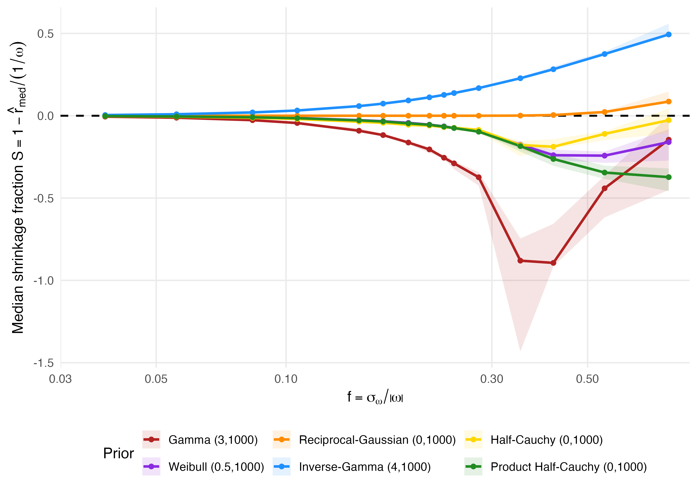

## The Curious Problem of the Normal Inverse Mean: Robustness and Shrinkage

### Soham Ghosh, Uttaran Chatterjee, and Jyotishka Datta

[arXiv:2410.20641](https://arxiv.org/abs/2410.20641)

### Contents

-  `/art`: all figures used in the main manuscript and supplementary materials.

- `/Rcodes/experiments/simulation_codes.R`: This code reproduces all (or most) simulation experiments and figures in the paper, namely, 
  - Likelihood plot
  - Setup A: squared error comparison across priors
  - Setup B: RMSE and mean squared relative error under varying noise 
  - Fixed-width rejection loss experiment
  - Near-zero posterior predictive discrepancy curves using Jensen--Shannon 
    divergence and L1 discrepancy
  - Sensitivity to prior scale for different values of $L \in \{500, 1000, 5000\}$

- `/Rcodes/experiments/MCMC_diagnostics.R`: As the name suggests, this is for producing the convergence diagnostic plots. It runs all six Stan models with 4 chains, and produces trace plot, autocorrelation plots, R-hat and ESS summary tables. 

- `/Rcodes/experiments/GDR1study.R`: This code reproduces the real-data analysis using the Gaia Data Release 1 (GDR1) dataset. The data is read from the file named `gdr1set01.csv`, and it computes posterior median distance estimates for 100 stars under six candidate priors.

### Dependencies

R packages: `rstan`, `ggplot2`, `dplyr`, `tidyr`, `patchwork`, `bayesplot`, 
`posterior`, `purrr`, `MCMCpack`, `pracma`, `ggdensity`, `reshape2`, 
`latex2exp`, `gridExtra`, `PolynomF`, `mvtnorm`, `plyr`, `parallel`, `here`
